**User Guide – Train-Office (RailJet)** · Mục lục:

1. [HƯỚNG DẪN SETUP TÍNH NĂNG OCR ĐỌC CCCD](#hướng-dẫn-setup-tính-năng-ocr-đọc-cccd)
2. [HƯỚNG DẪN CẤU HÌNH ĐĂNG NHẬP BẰNG GOOGLE](#hướng-dẫn-cấu-hình-đăng-nhập-bằng-google)
3. [HƯỚNG DẪN TÍCH HỢP THANH TOÁN VNPAY](#hướng-dẫn-tích-hợp-thanh-toán-vnpay)

---

# HƯỚNG DẪN SETUP TÍNH NĂNG OCR ĐỌC CCCD

*Quét Căn cước công dân để tự điền thông tin hành khách bằng Tesseract OCR*

Tài liệu này mô tả toàn bộ cách cài đặt, cách hoạt động, cách xử lý lỗi và những đánh đổi (trade-off) của tính năng **quét Căn cước công dân (CCCD) để tự điền thông tin hành khách** khi đặt vé.

Tính năng dùng **Tesseract OCR** (qua thư viện `tess4j`) chạy **hoàn toàn cục bộ trên server** — không gọi dịch vụ ngoài, không gửi ảnh CCCD lên internet.

## Phần 1. Kiến trúc tổng quan

```
Trình duyệt (passenger-info.html)
   │  ① người dùng bấm "Quét CCCD tự điền", chọn/chụp ảnh
   │  ② gửi ảnh qua AJAX: POST /booking/ocr-cccd  (multipart "image")
   ▼
OcrController  ──►  OcrService / OcrServiceImpl
   │                   ├─ Tiền xử lý ảnh (java.awt): grayscale, upscale, crop, nhị phân hóa
   │                   ├─ Lượt 1 (TEXT pass): quét cả thẻ  → tên, giới tính, ngày sinh có nhãn
   │                   ├─ Lượt 2 (DIGITS pass): crop vùng số + whitelist số → số CCCD, ngày sinh
   │                   └─ Bóc tách field bằng regex
   ▼
Trả JSON (CccdOcrResult) ──► JS tự điền vào các ô: fullName, identityNumber, dateOfBirth, gender
```

Các file liên quan:

| File | Vai trò |
|---|---|
| `controller/OcrController.java` | Endpoint `POST /booking/ocr-cccd` |
| `service/OcrService.java` | Interface |
| `service/impl/OcrServiceImpl.java` | Toàn bộ logic xử lý ảnh + OCR + bóc tách |
| `dto/CccdOcrResult.java` | Kết quả trả về (JSON) |
| `templates/booking/passenger-info.html` | Nút quét + overlay loading + script AJAX tự điền |
| `tessdata/vie.traineddata`, `tessdata/eng.traineddata` | Dữ liệu ngôn ngữ cho Tesseract |
| `pom.xml` | Dependency `net.sourceforge.tess4j:tess4j:5.13.0` |
| `application.properties` | Cấu hình đường dẫn tessdata, ngôn ngữ, vùng crop |

## Phần 2. Setup từ đầu đến cuối

### Bước 1: Dependency (đã có sẵn trong `pom.xml`)

```xml
<!-- Tesseract OCR engine (bundles native libs for Windows x64) for CCCD scanning -->
<dependency>
    <groupId>net.sourceforge.tess4j</groupId>
    <artifactId>tess4j</artifactId>
    <version>5.13.0</version>
</dependency>
```

> `tess4j` đã đóng gói sẵn thư viện native (`.dll`) cho **Windows x64**, nên trên Windows không cần cài Tesseract riêng.
>
> Nếu chạy trên **Linux/macOS** hoặc server production, cần cài Tesseract hệ thống (`apt install tesseract-ocr`, `brew install tesseract`) — xem Phần 6.

### Bước 2: Dữ liệu ngôn ngữ `tessdata/`

Thư mục `tessdata/` ở **gốc project** phải chứa:

- `vie.traineddata` — tiếng Việt (bắt buộc)
- `eng.traineddata` — tiếng Anh (hỗ trợ nhãn "Full name", số)

Đường dẫn được cấu hình tương đối so với thư mục chạy app (`ocr.tessdata-path=tessdata`), nên **phải chạy app từ gốc project** để tìm thấy thư mục này.

> **Lưu ý:** Hai file này nặng (~15MB + ~12MB). Cân nhắc có commit vào Git hay không (xem Phần 8).

### Bước 3: Cấu hình `application.properties`

```properties
# OCR (Tesseract) for CCCD scanning
spring.servlet.multipart.max-file-size=10MB
spring.servlet.multipart.max-request-size=10MB
ocr.tessdata-path=tessdata
ocr.language=vie+eng

# Vùng crop (theo tỉ lệ của thẻ đã cắt khung) cho lượt đọc số/ngày sinh.
# Chỉnh các giá trị này nếu ngày sinh bị cắt mất hoặc còn nhiễu.
ocr.dob-crop.x=0.30
ocr.dob-crop.y=0.28
ocr.dob-crop.w=0.70
ocr.dob-crop.h=0.45
```

| Khóa | Ý nghĩa |
|---|---|
| `spring.servlet.multipart.max-file-size` | Giới hạn kích thước ảnh upload (ảnh điện thoại dễ vượt 5MB) |
| `ocr.tessdata-path` | Đường dẫn tới thư mục `tessdata` |
| `ocr.language` | Ngôn ngữ nhận dạng, `vie+eng` = tiếng Việt + Anh |
| `ocr.dob-crop.*` | **Vùng crop cho lượt đọc số** (x, y, rộng, cao tính theo tỉ lệ 0–1) |

### Bước 4: Chạy & kiểm tra

```powershell
.\mvnw.cmd spring-boot:run
```

Rồi vào luồng đặt vé:

`http://localhost:8081/booking/search` → chọn chuyến → chọn ghế → **trang nhập thông tin hành khách** → bấm **"Quét CCCD tự điền"**.

Khi quét, server in ra console **log cả 2 lượt** (rất hữu ích để debug):

```
===== CCCD OCR text pass =====
...văn bản thô lượt 1...
===== CCCD OCR digits pass =====
...văn bản thô lượt 2 (chỉ số)...
```

## Phần 3. Cách hoạt động — vì sao phải quét 2 lần

Đây là phần cốt lõi và là quyết định thiết kế quan trọng nhất.

### Vấn đề của việc quét 1 lần (lý do ban đầu không đọc được số)

Khi đưa **nguyên tấm thẻ CCCD** vào Tesseract một lần duy nhất:

- Mặt trước CCCD có **rất nhiều hoa văn trang trí, họa tiết trống đồng, chữ chìm (micro-text), quốc huy, ảnh chân dung**.
- Tesseract cố đọc **tất cả** những thứ đó như thể là chữ → sinh ra một mớ ký tự rác.
- Dãy **số CCCD (12 chữ số)** và **ngày sinh** bị lẫn trong đống nhiễu đó, và thường bị đọc nhầm số thành chữ (ví dụ `0`→`O`, `1`→`l`, `8`→`B`).

→ Kết quả: **tên có thể đọc tạm được, nhưng dãy số gần như luôn sai**.

### Giải pháp đã chọn: 2 lượt quét chuyên biệt

Thay vì ép một lượt quét làm tốt mọi thứ, ta tách thành **2 lượt**, mỗi lượt tối ưu cho một mục tiêu:

#### Lượt 1 — TEXT pass (đọc chữ)

```java
BufferedImage gray = toGrayUpscaled(original, 1200);
textPass = ocr(gray, false);
```

- Lấy **cả thẻ**, chuyển **grayscale**, phóng to cạnh ngắn lên ≥ 1200px.
- Dùng để lấy **họ tên**, **giới tính**, và **ngày sinh ở dòng có nhãn "sinh"/"birth"**.

#### Lượt 2 — DIGITS pass (đọc số)

```java
BufferedImage region = toGrayUpscaled(cropRegion(original), 1600);
BufferedImage regionBinary = binarize(region);
digitsPass = ocr(regionBinary, true);
```

- **Crop** chỉ lấy **cột bên phải chứa Số / Ngày sinh / Giới tính** (bỏ ảnh chân dung + quốc huy — nguồn nhiễu chính).
- Phóng to mạnh hơn (≥ 1600px), rồi **nhị phân hóa Otsu** (chuyển hẳn về đen/trắng để tách chữ khỏi nền hoa văn).
- Trong lượt này, Tesseract bị **giới hạn chỉ được xuất ra chữ số**:

```java
tesseract.setPageSegMode(6);                                  // 1 khối văn bản đồng nhất
tesseract.setTessVariable("tessedit_char_whitelist", "0123456789/.-");
```

→ Số **không còn bị đọc nhầm thành chữ** nữa, vì bảng ký tự cho phép chỉ có số và dấu phân cách ngày.

### Tại sao cách này hiệu quả

Việc **cắt bỏ vùng hoa văn/ảnh** + **nhị phân hóa** + **whitelist chữ số** loại bỏ gần như toàn bộ nguyên nhân gây lỗi ở lần đọc đầu. Lượt số giờ chỉ "nhìn" vào vùng có số trên nền trắng sạch, nên đọc dãy 12 số chính xác hơn hẳn.

### Ghép kết quả 2 lượt

```java
String id   = firstNonNull(extractId(digitsPass), extractId(textPass)); // ưu tiên lượt số
LocalDate dob = extractDateOfBirth(textPass, digitsPass);               // ưu tiên dòng có nhãn "sinh"
String gender = extractGender(textPass);                                // "nam"/"nữ" từ lượt chữ
String fullName = extractFullName(textPass);                            // tên từ lượt chữ
```

- **Số CCCD**: ưu tiên lượt số, fallback về lượt chữ. Tìm 12 số liên tiếp (CCCD mới), nếu không có thì tìm 9 số (CMND cũ).
- **Ngày sinh**: ưu tiên ngày nằm trên dòng có chữ "sinh"/"birth"; nếu không, lấy **ngày hợp lệ sớm nhất** trong cả 2 lượt (ngày sinh luôn sớm hơn ngày cấp/hết hạn).
- **Giới tính**: dò từ "nam"/"nữ".
- Chỉ cần tìm được **ít nhất một** trường (id/dob/tên) thì coi là `success = true`.

## Phần 4. Xử lý khi lần đầu KHÔNG đọc được số/ảnh

Đây là tình huống thực tế hay gặp và cách xử lý tương ứng:

### Trình tự xử lý theo mức độ

1. **Luôn cho phép sửa tay.** Kết quả OCR chỉ là *best-effort* — trường nào không nhận được để `null`, không ghi đè. Thông báo luôn nhắc: *"Vui lòng kiểm tra lại các trường trước khi tiếp tục."* → Người dùng không bao giờ bị kẹt.
2. **Nếu đọc được chữ nhưng số sai/thiếu** → chính là lý do có **lượt 2 (DIGITS pass)**. Nếu lượt 2 vẫn chưa ra số, cần **chỉnh vùng crop**:
   - Mở log console, xem khối `===== CCCD OCR digits pass =====`.
   - Nếu phần số bị **cắt mất** → tăng `ocr.dob-crop.w` / `ocr.dob-crop.h`, hoặc giảm `ocr.dob-crop.x` / `ocr.dob-crop.y`.
   - Nếu còn **dính ảnh chân dung** (nhiễu) → tăng `ocr.dob-crop.x` để crop sâu hơn về bên phải.
   - Các giá trị này chỉnh trong `application.properties`, **không cần biên dịch lại**.
3. **Nếu hoàn toàn không ra gì** → thông báo: *"Không bóc tách được thông tin. Hãy nhập tay hoặc chụp lại rõ hơn."* và hướng dẫn người dùng chụp lại đúng khung (Phần 6).
4. **Nếu lỗi native/thiếu tessdata** → bắt `Throwable` (kể cả `UnsatisfiedLinkError`) và trả thông báo: *"OCR lỗi: … Kiểm tra thư mục tessdata và file vie.traineddata."*

### Bảng chẩn đoán nhanh

| Hiện tượng | Nguyên nhân thường gặp | Cách xử lý |
|---|---|---|
| Đọc được tên, sai số CCCD | Vùng crop chưa trúng / ảnh mờ | Chỉnh `ocr.dob-crop.*`, chụp nét hơn |
| Ngày sinh sai (lấy nhầm ngày cấp) | Nhãn "sinh" không đọc được | Chụp rõ dòng ngày sinh; logic đã ưu tiên ngày sớm nhất |
| Không ra gì cả | Ảnh nghiêng/thiếu sáng/sai khung | Chụp lại đúng khung, đủ sáng |
| `UnsatisfiedLinkError` / lỗi native | Thiếu tessdata hoặc Tesseract hệ thống | Kiểm tra `tessdata/`, cài Tesseract (Linux/mac) |
| Ảnh > 10MB bị từ chối | Vượt `max-file-size` | Tăng `spring.servlet.multipart.max-file-size` |

## Phần 5. Pros & Cons của cách tiếp cận này

### Ưu điểm (Pros)

- **Chạy offline, miễn phí**: không phụ thuộc API trả phí (Google Vision, FPT.AI…), không có chi phí/giới hạn request.
- **Bảo mật dữ liệu cá nhân**: ảnh CCCD **không rời khỏi server**, không gửi lên bên thứ ba — rất quan trọng với dữ liệu nhạy cảm như CCCD.
- **Không cần GPU**, cài đặt nhẹ, tận dụng native lib đóng gói sẵn cho Windows.
- **Tinh chỉnh được không cần build lại**: vùng crop, ngôn ngữ nằm trong `application.properties`.
- **Tăng đáng kể độ chính xác dãy số** nhờ chiến lược 2 lượt + whitelist.

### Nhược điểm (Cons)

- **Độ chính xác phụ thuộc mạnh vào chất lượng ảnh** (ánh sáng, độ nghiêng, độ nét, lóa). Không "thông minh" như dịch vụ AI chuyên dụng.
- **Vùng crop cố định theo tỉ lệ** → giả định ảnh được chụp tương đối đúng khung; thẻ đặt lệch/xoay sẽ crop trượt.
- **Phụ thuộc layout CCCD hiện hành** — nếu mẫu thẻ đổi bố cục, phải chỉnh lại crop/regex.
- **Không xác thực tính hợp lệ** của CCCD (không kiểm tra checksum, không chống ảnh giả) — chỉ là tiện ích tự điền.
- **Tốn RAM/CPU khi xử lý ảnh lớn** (upscale 1600px + Otsu toàn ảnh) và **chậm hơn** do chạy 2 lượt.

## Phần 6. Điều kiện để chạy được

### Điều kiện hệ thống

- Thư mục `tessdata/` có `vie.traineddata` (+ `eng.traineddata`) và app chạy **từ gốc project**.
- **Windows x64**: dùng native lib đóng gói trong `tess4j` → không cần cài gì thêm.
- **Linux/macOS/production**: cần cài **Tesseract hệ thống** và đảm bảo native lib khớp kiến trúc.
- `multipart` đang bật, giới hạn file đủ lớn cho ảnh điện thoại.

### Điều kiện về ảnh (người dùng chụp) — rất quan trọng

Để đọc tốt, ảnh CCCD cần:

- **Chụp đúng khung**: thẻ nằm gần kín khung hình, **không nghiêng/xoay**, các cạnh song song với mép ảnh. Đây là điều kiện tiên quyết vì **vùng crop lượt số dựa theo tỉ lệ** — thẻ lệch thì crop sẽ trượt khỏi vùng số.
- **Đủ sáng, không lóa**: tránh bóng đổ, tránh ánh sáng phản chiếu lên mặt thẻ (CCCD có lớp phủ dễ lóa).
- **Nét, phân giải cao**: chữ số rõ ràng; ảnh mờ là nguyên nhân số 1 khiến OCR sai.
- **Nền tương phản**, chụp thẳng (không chụp chéo góc gây méo phối cảnh).
- Định dạng **JPG/PNG**, dung lượng ≤ giới hạn `max-file-size`.

## Phần 7. Các hướng khác & vì sao không chọn (hiện tại)

Khi lần quét 1 không ra số, có nhiều hướng để cải thiện. Dưới đây là so sánh và lý do chọn hướng hiện tại (**crop + quét lại vùng số**):

| Hướng | Mô tả | Vì sao chưa chọn |
|---|---|---|
| **① Crop vùng số + quét lần 2** *(ĐÃ CHỌN)* | Cắt riêng cột chứa số, nhị phân hóa, whitelist chữ số | Đơn giản, miễn phí, offline, cải thiện ngay vấn đề cốt lõi (nhiễu hoa văn) |
| ② Gọi API OCR chuyên dụng (Google Vision, FPT.AI, VNPT eKYC) | Gửi ảnh lên dịch vụ AI | Tốn phí, cần internet, **gửi dữ liệu CCCD ra ngoài** (rủi ro bảo mật/pháp lý) |
| ③ Phát hiện biên thẻ tự động (OpenCV) + nắn phối cảnh | Tự tìm 4 góc thẻ, warp về chuẩn rồi mới crop | Phức tạp, thêm phụ thuộc nặng; chưa cần cho phạm vi đồ án |
| ④ Model deep learning tự train (nhận diện vùng + đọc số) | Train riêng cho CCCD VN | Cần dữ liệu + hạ tầng train, quá sức cho nhu cầu hiện tại |
| ⑤ Đọc chip NFC trên CCCD gắn chip | Lấy dữ liệu số từ chip | Cần đầu đọc NFC/điện thoại hỗ trợ + khóa bảo mật của Bộ Công an |

### Tại sao chọn hướng ① (quét lại vùng có số)

> **Vì lần quét đầu đọc "tất tần tật" cả hoa văn, họa tiết, chữ chìm trên thẻ → nhiễu nặng → không đọc tốt phần số.**
>
> Bằng cách **crop riêng vùng chứa số rồi quét thêm một lần nữa** (kèm nhị phân hóa + whitelist chỉ-số), ta loại bỏ nguồn nhiễu lớn nhất (ảnh chân dung, quốc huy, hoa văn) và ép Tesseract chỉ tập trung vào đúng dãy số. Đây là giải pháp **chi phí thấp, không cần dịch vụ ngoài, cải thiện ngay** đúng điểm yếu đã quan sát được — phù hợp nhất với phạm vi dự án.

## Phần 8. Trade-off tổng hợp

| Quyết định | Được | Mất / Đánh đổi |
|---|---|---|
| **Quét 2 lượt** (text + digits) | Số chính xác hơn nhiều | Chậm gấp ~2 lần, tốn CPU hơn |
| **Crop theo tỉ lệ cố định** | Đơn giản, chỉnh được qua config | Phụ thuộc ảnh chụp đúng khung; thẻ lệch là trượt |
| **Whitelist chỉ chữ số ở lượt 2** | Số không bị đọc nhầm thành chữ | Nếu crop trượt khỏi vùng số thì ra rỗng |
| **Nhị phân hóa Otsu** | Tách chữ khỏi nền hoa văn tốt | Ảnh lóa/bóng đổ có thể bị mất nét chữ |
| **Tesseract offline** (thay vì API AI) | Miễn phí, bảo mật, không cần mạng | Độ chính xác thấp hơn dịch vụ AI chuyên dụng |
| **Commit `tessdata/` vào Git** | Ai clone về là chạy được ngay | Repo phình ~27MB; cân nhắc `.gitignore` + tải riêng |
| **Luôn cho sửa tay, không ép** | Không bao giờ chặn người dùng | OCR chỉ là hỗ trợ, không đảm bảo đúng 100% |

## Phần 9. Tóm tắt một dòng

> Tính năng dùng **Tesseract chạy cục bộ**, quét CCCD **2 lượt** — lượt 1 đọc chữ (tên/giới tính/ngày sinh), lượt 2 **crop riêng vùng số + nhị phân hóa + chỉ cho đọc chữ số** để khắc phục việc lần quét đầu bị nhiễu bởi hoa văn trên thẻ. Kết quả chỉ để **tự điền gợi ý**, người dùng luôn kiểm tra/sửa tay. Điều kiện tiên quyết: **ảnh chụp đúng khung, nét, đủ sáng**.

---

# HƯỚNG DẪN CẤU HÌNH ĐĂNG NHẬP BẰNG GOOGLE

*Tạo OAuth 2.0 Client ID trên Google Cloud Console*

Tài liệu này hướng dẫn từng bước tạo project trên Google Cloud, cấu hình màn hình đồng ý OAuth (OAuth consent screen) và tạo **Client ID / Client Secret** để ứng dụng có thể cho phép người dùng đăng nhập bằng tài khoản Google.

**Chuẩn bị:** một tài khoản Google (Gmail) và địa chỉ chạy ứng dụng (ví dụ `http://localhost:8081`).

## Phần 1. Tạo project trên Google Cloud

### Bước 1: Truy cập Google Cloud Console

Mở trình duyệt, truy cập `https://console.cloud.google.com/` và đăng nhập bằng tài khoản Google của bạn.

Trên thanh tiêu đề, nhấn nút **Select a project** để mở danh sách project.

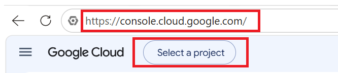

*Hình 1: Truy cập Google Cloud Console và nhấn Select a project*

### Bước 2: Tạo project mới

Trong hộp thoại **Select a resource**, nhấn nút **New project** ở góc trên bên phải.

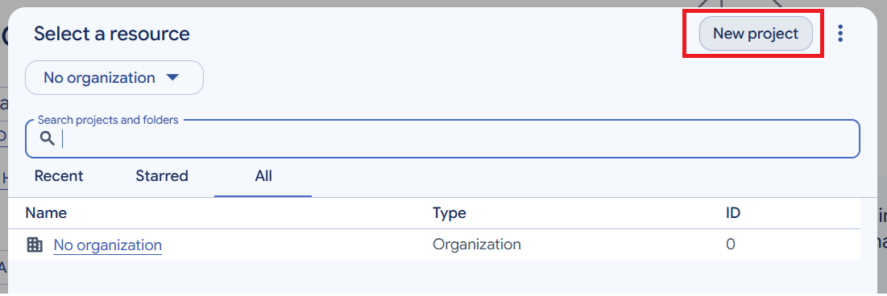

*Hình 2: Nhấn New project để tạo project mới*

### Bước 3: Nhập thông tin project

- **Project name**: nhập tên project.
- **Organization / Parent resource**: nếu dùng tài khoản cá nhân, giữ nguyên **No organization**.

Nhấn **Create** và chờ vài giây để Google tạo project. Sau đó nhấn **Select a project** và chọn đúng project vừa tạo.

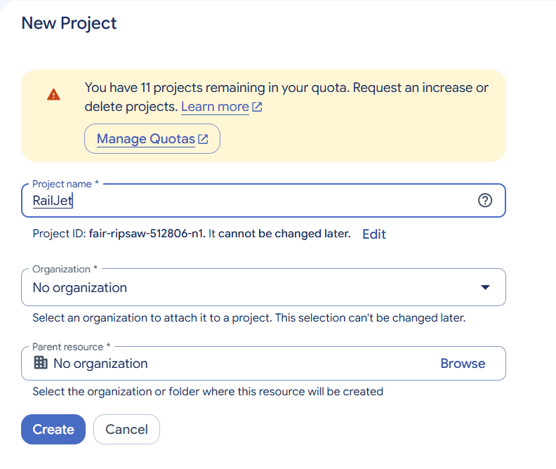

*Hình 3: Nhập tên project và nhấn Create*

## Phần 2. Cấu hình màn hình đồng ý OAuth (OAuth consent screen)

### Bước 4: Mở OAuth consent screen

Nhấn biểu tượng menu (☰) ở góc trái, di chuột vào **APIs & Services** và chọn **OAuth consent screen**.

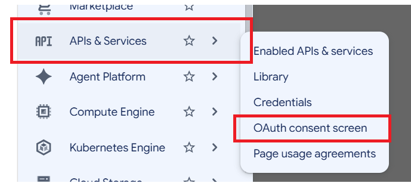

*Hình 4: Menu APIs & Services → OAuth consent screen*

### Bước 5: Chọn mục Branding

Trang **Google Auth Platform** hiện ra. Chọn mục **Branding** ở thanh bên trái (nếu project chưa được cấu hình, nhấn **Get started** để bắt đầu).

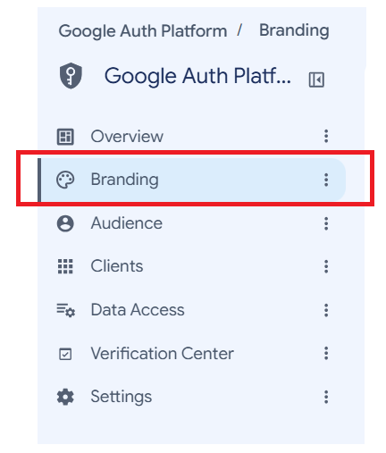

*Hình 5: Chọn Branding trong Google Auth Platform*

### Bước 6: App Information – Thông tin ứng dụng

- **App name**: tên ứng dụng sẽ hiển thị cho người dùng khi đăng nhập.
- **User support email**: chọn email hỗ trợ người dùng.

Nhấn **Next** để sang bước tiếp theo.

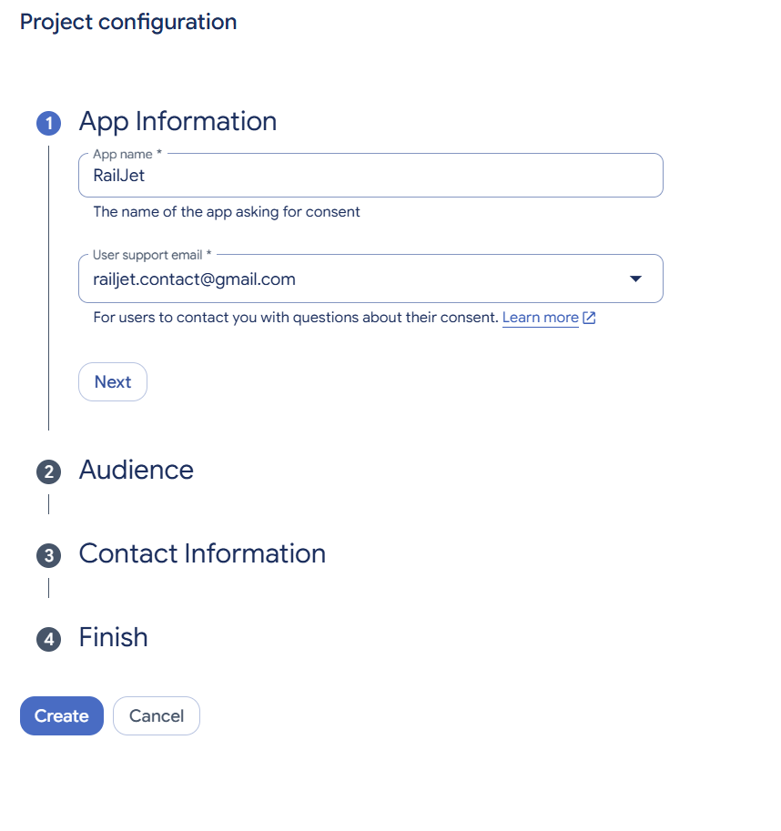

*Hình 6: Nhập App name và User support email*

### Bước 7: Audience – Đối tượng sử dụng

Chọn **External** để mọi tài khoản Google đều có thể đăng nhập (Internal chỉ dành cho tài khoản trong tổ chức Google Workspace). Nhấn **Next**.

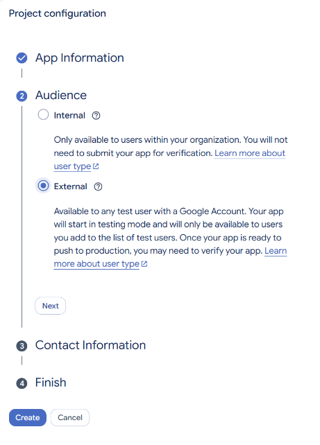

*Hình 7: Chọn External ở mục Audience*

### Bước 8: Contact Information – Thông tin liên hệ

Nhập địa chỉ email để Google gửi thông báo khi có thay đổi liên quan đến project, sau đó nhấn **Next**.

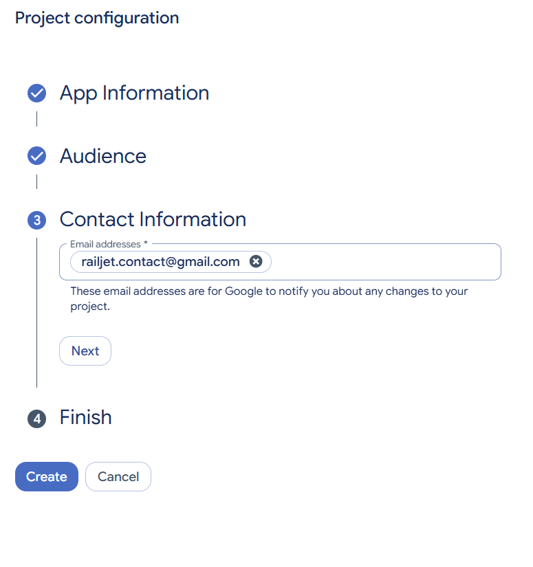

*Hình 8: Nhập email liên hệ*

### Bước 9: Finish – Hoàn tất

Tích chọn **I agree to the Google API Services: User Data Policy**, sau đó nhấn **Create** để hoàn tất cấu hình.

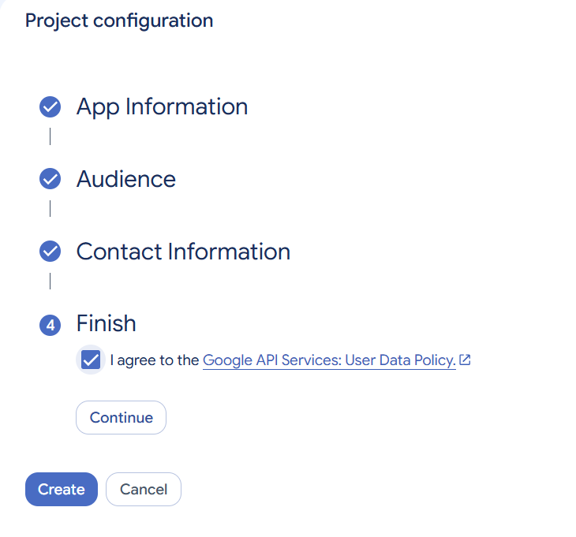

*Hình 9: Đồng ý chính sách và nhấn Create*

## Phần 3. Tạo OAuth Client ID

### Bước 10: Mở mục Clients

Trong **Google Auth Platform**, chọn mục **Clients** ở thanh bên trái, sau đó nhấn **+ Create client**.

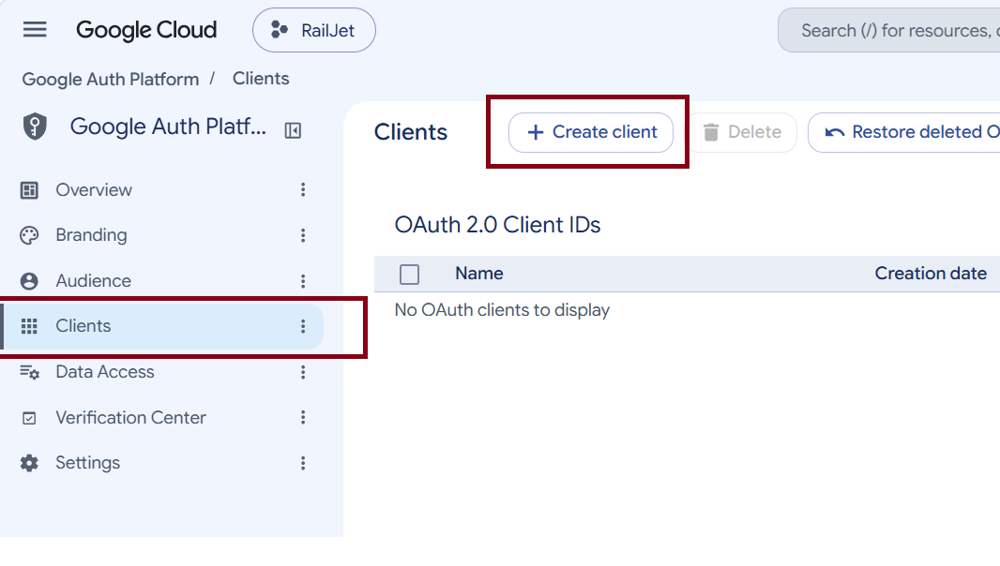

*Hình 10: Clients → Create client*

### Bước 11: Chọn loại ứng dụng

Tại ô **Application type**, chọn nền tảng thực tế của bạn.

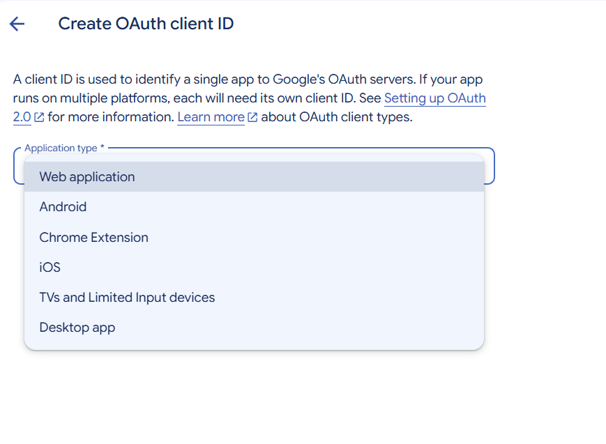

*Hình 11: Chọn Application type là Web application*

### Bước 12: Khai báo thông tin client và URI

- **Name**: tên client (chỉ dùng để nhận diện trong console), ví dụ `RailJet`.
- **Authorized JavaScript origins**: nhấn **+ Add URI** và nhập địa chỉ gốc của ứng dụng, đây sẽ là nơi tích hợp login google, ví dụ `http://localhost:8081`.
- **Authorized redirect URIs**: nhấn **+ Add URI** và nhập đường dẫn callback mà Google sẽ chuyển hướng về sau khi đăng nhập, đây sẽ là url bạn cần xử lí ở controller để lấy được thông tin đăng nhập của người dùng, ví dụ `http://localhost:8081/google-login`.

Nhấn **Create** để tạo client.

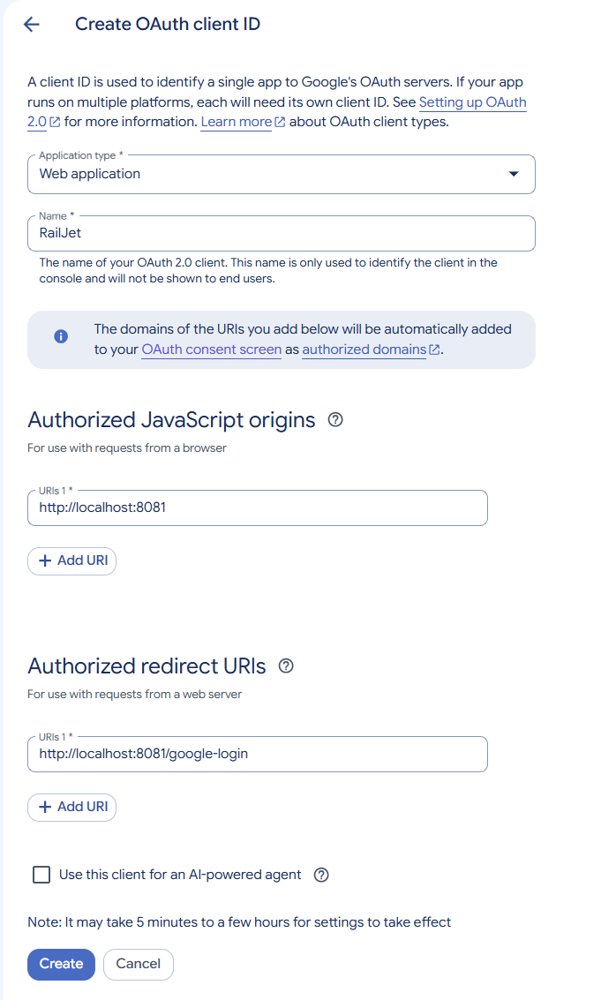

*Hình 12: Nhập Name, JavaScript origins và Redirect URIs*

### Bước 13: Lưu Client ID và Client Secret

Hộp thoại **OAuth client created** hiển thị **Client ID** và **Client secret**. Nhấn biểu tượng sao chép để copy, hoặc nhấn **Download JSON** để tải về.

Đưa Client ID và Client Secret vào file cấu hình của ứng dụng để kích hoạt chức năng đăng nhập bằng Google. Nhấn **OK** để đóng hộp thoại.

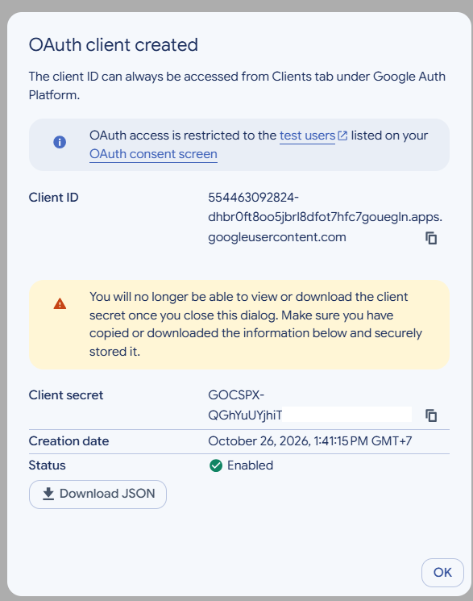

*Hình 13: Sao chép Client ID và Client Secret*

> **Quan trọng:** Client secret chỉ hiển thị một lần – sau khi đóng hộp thoại sẽ không xem hay tải lại được. Hãy lưu lại ngay và không đưa secret lên Git hoặc chia sẻ công khai.

## Phần 4. Viết code đăng nhập bằng Google

**Luồng xử lý:** người dùng nhấn **Đăng nhập bằng Google** → ứng dụng chuyển hướng sang Google → người dùng chọn tài khoản → Google chuyển hướng về **Redirect URI** kèm `code` → ứng dụng đổi `code` lấy thông tin người dùng và tạo phiên đăng nhập.

### Bước 14: Khai báo Client ID và Client Secret trong ứng dụng

Thêm các thông tin đã lưu ở Bước 13 vào file `application.properties`:

```properties
google.client-id=YOUR_CLIENT_ID
google.client-secret=YOUR_CLIENT_SECRET
google.redirect-uri=http://localhost:8081/google-login
```

Trong code, đọc các giá trị này bằng `@Value("${google.client-id}")`

> **Lưu ý:** `google.redirect-uri` phải trùng khớp hoàn toàn với **Authorized redirect URIs** đã khai báo ở Bước 12.

### Bước 15: Chuyển hướng người dùng sang Google

Khi người dùng nhấn nút đăng nhập, ứng dụng tạo URL đăng nhập của Google với các tham số sau:

| Tham số | Ý nghĩa |
|---|---|
| `client_id` | Client ID lấy ở Bước 13. |
| `redirect_uri` | Địa chỉ Google chuyển hướng về sau khi đăng nhập. |
| `response_type` | Cố định `code`: Google trả về mã ủy quyền. |
| `scope` | Cố định `openid email profile`: quyền đọc email, họ tên, ảnh đại diện. |
| `state` | Chuỗi ngẫu nhiên chống giả mạo yêu cầu (CSRF), lưu trong Session. |
| `prompt` | Đặt `select_account` để luôn hiện màn hình chọn tài khoản. |

```java
@GetMapping("/oauth2/login/google")
public String redirectToGoogle(HttpSession session) {
    // 1. Sinh state ngẫu nhiên chống CSRF, lưu vào Session
    String state = UUID.randomUUID().toString();
    session.setAttribute("OAUTH2_STATE", state);

    // 2. Gom tham số theo chuẩn Google OAuth 2.0
    Map<String, String> params = new LinkedHashMap<>();
    params.put("client_id", googleClientId);
    params.put("redirect_uri", googleRedirectUri);
    params.put("response_type", "code");
    params.put("scope", "openid email profile");
    params.put("state", state);
    params.put("prompt", "select_account");

    // 3. URL encode từng giá trị và nối bằng "&"
    String query = params.entrySet().stream()
        .map(e -> e.getKey() + "="
                + URLEncoder.encode(e.getValue(), StandardCharsets.UTF_8))
        .collect(Collectors.joining("&"));

    // 4. Chuyển hướng sang trang đăng nhập của Google
    return "redirect:https://accounts.google.com/o/oauth2/v2/auth?" + query;
}
```

### Bước 16: Xử lý kết quả trả về (Redirect URI)

Sau khi người dùng chọn tài khoản, Google chuyển hướng về Redirect URI kèm hai tham số `code` và `state`. Ứng dụng xử lý theo 4 bước:

- **Kiểm tra state:** so với giá trị đã lưu trong Session. Không khớp → từ chối, vì yêu cầu có thể bị giả mạo.
- **Đổi code lấy access_token:** gửi POST tới `https://oauth2.googleapis.com/token` kèm Client ID và Client Secret.
- **Lấy thông tin người dùng:** dùng `access_token` gọi `https://www.googleapis.com/oauth2/v3/userinfo` để lấy `email`, `name`.
- **Đăng nhập hoặc đăng ký:** tìm user theo email. Chưa có thì tự tạo tài khoản mới, sau đó tạo phiên đăng nhập.

```java
@GetMapping("/google-login")
public String handleGoogleCallback(@RequestParam("code") String code,
                                   @RequestParam("state") String state,
                                   HttpSession session,
                                   HttpServletResponse response) {
    // 1. Kiểm tra state chống CSRF
    String savedState = (String) session.getAttribute("OAUTH2_STATE");
    session.removeAttribute("OAUTH2_STATE");
    if (savedState == null || !savedState.equals(state)) {
        throw new SecurityException("State không hợp lệ hoặc phiên đã hết hạn");
    }

    // 2. Đổi code lấy access_token
    RestTemplate restTemplate = new RestTemplate();
    MultiValueMap<String, String> form = new LinkedMultiValueMap<>();
    form.add("code", code);
    form.add("client_id", googleClientId);
    form.add("client_secret", googleClientSecret);
    form.add("redirect_uri", googleRedirectUri);
    form.add("grant_type", "authorization_code");
    Map<String, Object> token = restTemplate.postForObject(
            "https://oauth2.googleapis.com/token", form, Map.class);
    String accessToken = (String) token.get("access_token");

    // 3. Lấy thông tin người dùng bằng access_token
    HttpHeaders headers = new HttpHeaders();
    headers.setBearerAuth(accessToken);
    Map<String, Object> googleUser = restTemplate.exchange(
            "https://www.googleapis.com/oauth2/v3/userinfo", HttpMethod.GET,
            new HttpEntity<>(headers), Map.class).getBody();
    String email = (String) googleUser.get("email");
    String fullName = (String) googleUser.get("name");

    // 4. Tìm user theo email, chưa có thì tạo mới
    User user = userRepository.findByEmail(email).orElseGet(() -> {
        User newUser = new User();
        newUser.setEmail(email);
        newUser.setFullName(fullName);
        newUser.setRole(UserRole.CUSTOMER);
        newUser.setStatus(UserStatus.ACTIVE);
        // Mật khẩu ngẫu nhiên vì user này đăng nhập qua Google
        newUser.setPassword(passwordEncoder.encode(UUID.randomUUID().toString()));
        return userRepository.save(newUser);
    });

    // 5. Tạo phiên đăng nhập (JWT cookie) và chuyển vào trang chính
    authCookie.signIn(response, user);
    return "redirect:/booking/search";
}
```

> **Lưu ý:** Đường dẫn `@GetMapping` của hàm này phải trùng với Redirect URI (ở đây là `/google-login`). Nếu người dùng nhấn **Hủy** trên trang Google, Google trả về `error=access_denied` và không có `code`. Nên đặt `@RequestParam(value = "code", required = false)` và chuyển người dùng về trang đăng nhập khi `code` rỗng.

### Bước 17: Thêm nút đăng nhập và chạy thử

Trên trang đăng nhập, thêm nút trỏ tới đường dẫn ở Bước 15:

```html
<a href="/oauth2/login/google" class="btn btn-outline-dark">Đăng nhập bằng Google</a>
```

Chạy ứng dụng, nhấn nút và chọn tài khoản Google. Nếu cấu hình đúng, người dùng được chuyển vào trang chính và tài khoản được lưu vào cơ sở dữ liệu.

> **Lưu ý:** Khi ứng dụng còn ở chế độ **Testing** (Bước 7), chỉ tài khoản có trong **Test users** mới đăng nhập được. Nếu gặp lỗi `redirect_uri_mismatch`, kiểm tra lại Redirect URI ở Bước 12 và Bước 14.

---

# HƯỚNG DẪN TÍCH HỢP THANH TOÁN VNPAY

*Kết nối ứng dụng với môi trường VNPay Sandbox*

Tài liệu này hướng dẫn kết nối ứng dụng với môi trường thử nghiệm (Sandbox) của VNPay: tạo URL thanh toán, chuyển người dùng sang trang VNPay và nhận kết quả trả về để cập nhật trạng thái đơn hàng.

**Luồng xử lý:** người dùng tạo booking → hệ thống tạo `Payment` ở trạng thái `PENDING` → chuyển hướng sang VNPay → người dùng thanh toán → VNPay chuyển hướng về **Return URL** → hệ thống kiểm tra chữ ký và cập nhật `Payment` / `Booking`.

**Chuẩn bị:** một địa chỉ email để đăng ký tài khoản Sandbox và địa chỉ chạy ứng dụng (ví dụ `http://localhost:8080`).

## Phần 1. Đăng ký và cấu hình VNPay Sandbox

### Bước 1: Đăng ký tài khoản Sandbox

Truy cập `https://sandbox.vnpayment.vn/devreg/` và điền thông tin đăng ký. Sau khi đăng ký, VNPay gửi qua email hai thông tin:

- **vnp_TmnCode**: mã định danh website (merchant) trên hệ thống VNPay.
- **vnp_HashSecret**: khóa bí mật dùng để ký và kiểm tra chữ ký dữ liệu.

> **Quan trọng:** `vnp_HashSecret` có vai trò như mật khẩu. Không đưa lên Git hoặc chia sẻ công khai.

### Bước 2: Khai báo cấu hình trong ứng dụng

Thêm các thông tin VNPay vào file `application.properties`:

```properties
vnpay.tmn-code=YOUR_TMN_CODE
vnpay.hash-secret=YOUR_HASH_SECRET
vnpay.pay-url=https://sandbox.vnpayment.vn/paymentv2/vpcpay.html
vnpay.return-url=http://localhost:8080/payments/vnpay-return
```

Trong code, đọc các giá trị này bằng `@Value("${vnpay.hash-secret}")` (tương tự cho các key còn lại).

## Phần 2. Viết các hàm tiện ích trong VnpayUtils

### Bước 3: Hàm ký dữ liệu hmacSHA512

VNPay dùng thuật toán **HMAC-SHA512** để ký dữ liệu. Thêm hàm sau vào lớp tiện ích `VnpayUtils`:

```java
public static String hmacSHA512(String key, String data) {
    try {
        // 1. Khởi tạo bộ tính HMAC với thuật toán SHA-512
        Mac mac = Mac.getInstance("HmacSHA512");
        // 2. Nạp khóa bí mật (vnp_HashSecret)
        byte[] keyBytes = key.getBytes(StandardCharsets.UTF_8);
        mac.init(new SecretKeySpec(keyBytes, "HmacSHA512"));
        // 3. Băm chuỗi dữ liệu và chuyển kết quả sang dạng hex
        byte[] hash = mac.doFinal(data.getBytes(StandardCharsets.UTF_8));
        return HexFormat.of().formatHex(hash);
    } catch (Exception e) {
        throw new RuntimeException("Không tạo được chữ ký HMAC-SHA512", e);
    }
}
```

**Hàm này làm gì?** Nhận vào khóa bí mật (`key`) và chuỗi tham số (`data`), trả về một chuỗi hex dài 128 ký tự. Chuỗi này chính là chữ ký `vnp_SecureHash`.

- **Cùng dữ liệu + cùng khóa → luôn ra cùng một chữ ký.** Nhờ vậy, VNPay và ứng dụng có thể tự tính rồi so sánh với nhau.
- **Dữ liệu thay đổi dù chỉ 1 ký tự → chữ ký thay đổi hoàn toàn.** Ai đó sửa số tiền hay mã kết quả trên URL sẽ bị phát hiện ngay.
- **Không có khóa bí mật thì không tạo được chữ ký hợp lệ.** Vì khóa chỉ ứng dụng và VNPay biết, chữ ký chứng minh dữ liệu đến từ đúng bên.

Hàm được dùng ở hai chỗ:

- **Khi tạo URL thanh toán** (Bước 5): ký tham số gửi đi. Thiếu hoặc sai chữ ký, VNPay báo lỗi “Sai chữ ký” và từ chối giao dịch.
- **Khi nhận kết quả** (Bước 6): tính lại chữ ký và so với `vnp_SecureHash` VNPay gửi về, để chắc chắn kết quả không bị giả mạo.

> **Lưu ý:** `HexFormat` chỉ có từ **Java 17**. Nếu dự án dùng Java cũ hơn, thay dòng `return HexFormat...` bằng đoạn sau:

```java
StringBuilder sb = new StringBuilder();
for (byte b : hash) {
    sb.append(String.format("%02x", b));
}
return sb.toString();
```

### Bước 4: Hàm ghép chuỗi tham số buildQuery

Trước khi ký, các tham số phải được ghép thành chuỗi đúng quy tắc của VNPay: **sắp xếp tên tham số theo A–Z**, bỏ giá trị rỗng, URL encode từng cặp và nối bằng dấu `&`.

```java
public static String buildQuery(Map<String, String> params) {
    // TreeMap tự sắp xếp key theo A-Z
    return new TreeMap<>(params).entrySet().stream()
        .filter(e -> e.getValue() != null && !e.getValue().isBlank())
        .map(e -> URLEncoder.encode(e.getKey(), StandardCharsets.UTF_8) + "="
                + URLEncoder.encode(e.getValue(), StandardCharsets.UTF_8))
        .collect(Collectors.joining("&"));
}
```

Kết quả có dạng `vnp_Amount=5000000&vnp_Command=pay&vnp_CreateDate=...`. Chuỗi này vừa dùng làm query string của URL, vừa là dữ liệu đưa vào `hmacSHA512`, nên hai chỗ phải dùng **cùng một chuỗi**.

## Phần 3. Tạo thanh toán và nhận kết quả

### Bước 5: Tạo URL thanh toán

Sau khi người dùng tạo booking, tạo `Payment` ở trạng thái `PENDING`, sau đó gom tham số, ký và chuyển hướng sang VNPay:

```java
Map<String, String> params = new HashMap<>();
params.put("vnp_Version", "2.1.0");
params.put("vnp_Command", "pay");
params.put("vnp_TmnCode", tmnCode);
// VNPay yêu cầu số tiền nhân 100
params.put("vnp_Amount", String.valueOf(amount * 100));
params.put("vnp_CurrCode", "VND");
// Mã tham chiếu duy nhất cho mỗi giao dịch
params.put("vnp_TxnRef", payment.getPaymentId().toString());
params.put("vnp_OrderInfo", "Thanh toan don hang " + bookingNumber);
params.put("vnp_OrderType", "other");
params.put("vnp_Locale", "vn");
params.put("vnp_ReturnUrl", returnUrl);
params.put("vnp_IpAddr", request.getRemoteAddr());
DateTimeFormatter fmt = DateTimeFormatter.ofPattern("yyyyMMddHHmmss");
params.put("vnp_CreateDate", LocalDateTime.now().format(fmt));

String query = VnpayUtils.buildQuery(params);
String secureHash = VnpayUtils.hmacSHA512(hashSecret, query);
String paymentUrl = payUrl + "?" + query + "&vnp_SecureHash=" + secureHash;

return "redirect:" + paymentUrl;
```

- `vnp_Amount`: số tiền **nhân 100** (50.000 VNĐ → gửi `5000000`).
- `vnp_TxnRef`: mã tham chiếu, không được trùng giữa các giao dịch. Dùng `paymentId` để tra lại `Payment` khi VNPay trả kết quả.
- `vnp_OrderInfo`: nên viết tiếng Việt **không dấu**.

### Bước 6: Xử lý kết quả trả về (Return URL)

Sau khi người dùng thanh toán (hoặc hủy), VNPay chuyển hướng trình duyệt về `vnp_ReturnUrl` kèm các tham số kết quả:

```java
@GetMapping("/payments/vnpay-return")
public ResponseEntity<?> vnpayReturn(@RequestParam Map<String, String> params) {
    String receivedHash = params.remove("vnp_SecureHash");
    params.remove("vnp_SecureHashType");

    // 1. Kiểm tra chữ ký
    String query = VnpayUtils.buildQuery(params);
    String expectedHash = VnpayUtils.hmacSHA512(hashSecret, query);
    if (!expectedHash.equalsIgnoreCase(receivedHash)) {
        return ResponseEntity.badRequest().body("Chữ ký không hợp lệ");
    }

    // 2. Cập nhật trạng thái
    UUID paymentId = UUID.fromString(params.get("vnp_TxnRef"));
    Payment payment = paymentRepository.findById(paymentId).orElseThrow();
    if ("00".equals(params.get("vnp_ResponseCode"))) {
        payment.setPaymentStatus(PaymentStatus.SUCCESS);
        payment.setTransactionCode(params.get("vnp_TransactionNo"));
        payment.getBooking().setBookingStatus(BookingStatus.PAID);
    } else {
        payment.setPaymentStatus(PaymentStatus.FAILED);
    }
    paymentRepository.save(payment);
    return ResponseEntity.ok(payment.getPaymentStatus());
}
```

- **Kiểm tra chữ ký:** bỏ `vnp_SecureHash` và `vnp_SecureHashType` ra khỏi danh sách, ghép lại các tham số còn lại bằng `buildQuery`, ký bằng `hmacSHA512` rồi so với chữ ký nhận được. Không khớp → dữ liệu đã bị sửa, không cập nhật đơn hàng.
- **Cập nhật trạng thái:** `vnp_ResponseCode = "00"` là thanh toán thành công; mã khác là thất bại hoặc người dùng hủy. Lưu `vnp_TransactionNo` (mã giao dịch phía VNPay) để đối soát.

## Phần 4. Thanh toán thử

### Bước 7: Thanh toán thử bằng thẻ Sandbox

Trên trang thanh toán VNPay, chọn **Thẻ nội địa và tài khoản ngân hàng** → ngân hàng **NCB**, rồi nhập thông tin thẻ test:

| Thông tin | Giá trị |
|---|---|
| Ngân hàng | NCB |
| Số thẻ | `9704198526191432198` |
| Tên chủ thẻ | `NGUYEN VAN A` |
| Ngày phát hành | `07/15` |
| Mật khẩu OTP | `123456` |

Nếu cấu hình đúng, trình duyệt quay về Return URL và `Payment` chuyển sang `SUCCESS`, `Booking` chuyển sang `PAID`.
